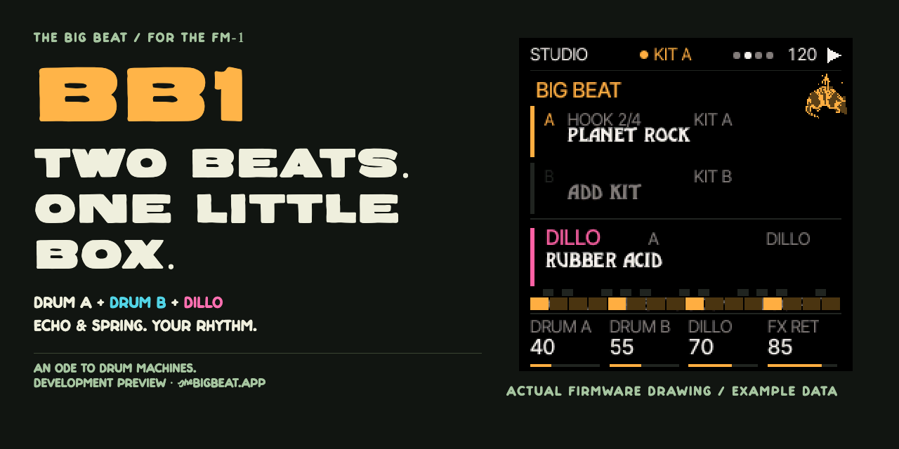

<p align="center">
  
</p>
<p align="center">
  <b><a href="https://thebigbeat.app/fm1/install/">Install (one click)</a></b> · <b><a href="https://thebigbeat.app/fm1/emulator/">Play it in your browser</a></b> · <a href="https://thebigbeat.app/fm1/guide/">Player's guide</a> · <a href="https://thebigbeat.app/fm1/">thebigbeat.app/fm1</a>
</p>
<p align="center">
     
</p>

# BB1 — the FM-1 becomes a rhythm machine

**Two drum machines at once. A bass synth with attitude. A tape echo and a spring on everything.** BB1 rewires the FM-1 into a pocket studio built for one job: grooves. Load a beat from five decades of drum machines, stack a second machine on top, let **Dillo** find the bassline, then grab the knobs and push it until something breaks.

```
          1 . . . 2 . . . 3 . . . 4 . . .
  KIT A   ■ · · · · · ■ · · · ■ · · · · ·   808, live
  KIT B   · · · · ■ · · · · · · · ■ · · ·   DMX, sampled
  DILLO   ■ · ■ ■ · · ■ · ■ · · ■ · · ■ ·   acid bass
  ECHO    ═══════════════════════════════▶  REC + FX
```

## What's in the box

|  |  |
|---|---|
| **KIT A + KIT B** | Two independent drum machines running together, each with its own pattern, kit and level. A Linn groove under an 808? Go on. |
| **Eight machines** | The **808**, synthesised in real time, plus seven sampled machines: **LinnDrum**, **DrumTraks**, **DMX**, **LM-1**, **Simmons**, **Rhythm King** and **Drumulator**. Swap the machine under a pattern and it lands on the next bar. |
| **Dillo** | A monophonic bass synth with nine presets, including Square Acid, from rubbery acid to hollow dub. Every era brings its own line. |
| **Echo & spring** | A three-head tape echo and a spring reverb, shared by everything. Hold **REC + FX** for a dub throw. |
| **67 songs** | 233 playable drum sections, with catalogue tempos and swing. |
| **205 ACID phrases** | 27 Dillo banks, with accents and slides, alongside songs and eras. |
| **21 eras** | Big Beat originals, from Motorik to rave, each with its own Dillo bassline. |
| **138 classic rhythms** | The preset rhythms of four vintage rhythm boxes: waltzes, bossa novas, rock and everything between. |
| **Changes on the beat** | New kits and patterns wait for the bar line. The screen says **NEXT** until they land. |

## Get it on your FM-1

1. Plug the FM-1 into a computer with a USB **data** cable, and open **[thebigbeat.app/fm1/install](https://thebigbeat.app/fm1/install/)** in Chrome or Edge.
2. Press **Install BB1** once. The installer handles the firmware and sounds together, checking the existing library before writing it. Allow about five minutes. The installer preserves the user-data regions. Keep a backup: preserved bytes do not guarantee compatibility with older firmware.
3. With **MASTER** down, press **HOME**, then **PLAY**. Bring **MASTER** up gently.

Want it gone? Go back to M-VAVE's official firmware any time with M-VAVE's own updater and their `FM-1.fwsc`. BB1 can't export its music to the computer yet, so copy out anything you want to keep before you switch.

**Try before you flash:** the [browser player](https://thebigbeat.app/fm1/emulator/) runs the real BB1 firmware, the same screen and the same engine, right in your browser. Then read **[the guide](https://thebigbeat.app/fm1/guide/)**.

## Controls in ten seconds

```
  HOME ········· back to STUDIO from anywhere (hold it for help)
  SELECT ······· who you're playing: KIT A · KIT B · DILLO
  PRESETS ······ turn to browse kits, EDIT to load
  ALGORITHM ···· turn to browse songs, eras and patterns, EDIT to load
  FX ··········· echo, tape, spring, motion, sends
  REC + FX ····· dub throw: the echo opens wide, then snaps back
  four knobs ··· always do what the bottom of the screen says
```

## Known limits

- **Saving:** on an FM-1 that came with its own firmware, a scene can still hold that firmware's data. BB1 shows **SCENE n HAS OTHER DATA** and writes nothing until you hold **SAVE** for two seconds, which replaces it. BB1 never loads that old data. This has been tested on an FM-1: save, load, a power cycle, a second save, and a return to 1.1 and back.
- **Headroom:** the released lead-off candidate passed its recorded two-drum tests within the audio deadline, above the preferred processing headroom. Experimental Duo/Fix A tests exceeded the deadline and are not included. Not every arrangement has been tested.
- **First tempo edit:** in the browser, loading a song can update playback to its own tempo while the header/control mirror retains 120. The first GLOBAL tempo increment can therefore jump from 87 to 121 instead of 88. Set the intended tempo explicitly. This source/UI issue is open; physical FM-1 behavior has not been tested.
- **Rollback:** returning to 1.2 resets global preferences, including MIDI settings. 1.2 scenes load in 1.5; 1.2 refuses scenes saved by experimental builds with the lead enabled. Keep a compatible backup.
- **Substitute voices:** a missing voice plays a substitute, and the pattern itself is unchanged. On a native 808 drum B, synth percussion plays as cowbell and zap as high tom.
- **The browser player** runs the released engine with the native 808 and the seven-machine sound library. It lets you try the layout, controls and sound; browser results do not prove FM-1 hardware timing or scene persistence.

## Build it yourself

Everything here is the complete source of the released firmware. One command rebuilds it and proves it matches, **given the pinned build inputs** (see below):

```sh
python3 -I big-beat/integration/verify_release.py . /tmp/bb1-1.5-check --recipe candidate \
  --expect-tree 80f2e431b45e67a595c4d8c7f3031b89d002b00b83f134058aa4acc4739c85eb \
  --expect-app c3a703a388e8c274585b27097a888d30b3c4f2b92c57e1077cee9e4ebf0d3380 \
  --expect-package 2ef5f0112657e25fcce3f25d3e9be6eb6ba1832d941386cbf3543a450686dcfc
```

Those are the identities of **BB1 1.5: Acid Dillo** (`bb1-1.5.fwsc`, 610,086 bytes), built from the lead's `c04aa9f` source with the `candidate` recipe: Dillo enabled, Telegram and Fix A disabled. Duo remains future work. The seven-machine sound library is unchanged from 1.2: `154ef6b92553af5803c3e003dc5d2c379aed4e0503f24f08ad8b024cff7d821e` (245,760 bytes). Earlier releases remain available for rollback.

The verifier runs host suites, the worker/serial oracle, level checks, the from-source target build and deterministic packaging, including negative cases. Exit 0 proves the expected bytes match. It does not prove hardware acceptance. Exact install/readback and two 65-second two-drum runs passed on the FM-1 with zero fault or miss counters; their retained maximum was 5,475.3 µs against a 5,802.7 µs deadline. The second run retained the first run's boot-cumulative maximum. Physical ACID, three-focus and Square Acid walkthroughs remain unperformed on this candidate while Joe is remote. See `BB1-1.5-HARDWARE-RECEIPT.json` and [the build instructions](BB1-1.5-BUILD.md).

**Build inputs:** external inputs are checked against `big-beat/integration/inputs.json` by SHA-256. The JieLi `pi32v2` toolchain, linker overlay, asset symbols/object and pinned Docker image are external dependencies. Some paths still refer to our build machine. A fresh checkout cannot reproduce the target bytes without those exact inputs and path mappings; they are not bundled or downloaded by the verification command. The included SDK package notices remain Apache-2.0. [BUILDING.md](BUILDING.md) puts the BB1 release route first and keeps upstream Felucca instructions as reference.

## Licence

The Acid Tabs phrases credit **J. McConaghy / Acid-Tabs.com**, [CC BY-SA 4.0](https://creativecommons.org/licenses/by-sa/4.0/); phrases were renamed, revoiced and retimed for Dillo. Further provenance and permissions are in `BIG-BEAT-LICENSING.md`.

GNU GPL v3. See `LICENSE`, `LICENSING.md`, `LICENSES/` and `BIG-BEAT-LICENSING.md`. BB1 is a Felucca-family firmware; upstream notices are kept in `LICENSING.md`. M-VAVE, FM-1, Roland, TR-808, Linn, LinnDrum, LM-1, DrumTraks, Sequential, DMX, Oberheim, Simmons, E-mu, Drumulator and Rhythm King are trademarks of their respective owners. BB1 is independent and not affiliated with or endorsed by them. **No warranty:** you install it at your own risk.

```
  ────────────────────────────────────────────────────────────────
   OLE BIG BEAT LTD  ·  thebigbeat.app
  ────────────────────────────────────────────────────────────────
```
